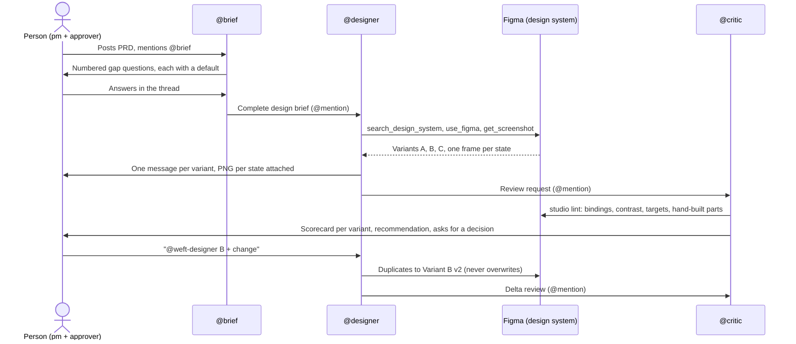

<br/>
<p align="center">
<picture>
  <source media="(prefers-color-scheme: dark)" srcset="./branding/switchboard-studio-dark.svg">
  <source media="(prefers-color-scheme: light)" srcset="./branding/switchboard-studio.svg">
  
</picture>
</p>

<br/>

<p align="center">
  <a href="https://github.com/romeet9/switchboard-studio/actions/workflows/test.yml"></a> &nbsp;<a href="https://github.com/sandbox-quantum/switch"></a> &nbsp;<a href="https://help.figma.com/hc/en-us/articles/32132100833559-Guide-to-the-Figma-MCP-server"></a> &nbsp;<a href="./LICENSE"></a> &nbsp;<a href="https://www.wemakedevs.org/hackathons/switch"></a></p>

<h1 aria-hidden="true"></h1>

<br/>

Drop a product brief in Slack. Three AI teammates turn it into on-system Figma designs, a measured critique, and a decision that stays with you.

Demo video: TODO_VIDEO_URL

Entry for the **Flip the Switch** hackathon (WeMakeDevs × DevTools Academy × Switch), Track 01: Best Business Workflow. Built by Romeet Chatterjee, a product designer ([@romeet9](https://github.com/romeet9)).

## 🔗 Links

- [Demo video](TODO_VIDEO_URL)
- [Switch](https://github.com/sandbox-quantum/switch) (the room and agent platform)
- [Switch docs](https://docs.switchagents.ai)
- [Hackathon page](https://www.wemakedevs.org/hackathons/switch)
- [Blog post](./docs/blog-post.md)
- [Demo script](./docs/demo-script.md)

## ✨ Features

- **Three agents in one room.** A brief agent, a designer and a critic share one chat thread with you.
- **Built from your published design system.** Every frame uses components and variables from your Figma library, not one-off styles.
- **Measured design-system lint.** Variable binding %, text styles, library instances, WCAG contrast and 24 px targets, as numbers rather than opinions.
- **Clean per-state PNGs in chat.** Reviewers see every state without opening Figma.
- **The human approves.** Agents recommend, you decide in words. Versions are never overwritten: "B + change" makes `B v2`.
- **Runs entirely from Slack.** After setup there is no terminal. Mattermost is built in if you do not use Slack.
- **A dependency-free CLI with tests and CI.** Plain Node, `npm test`, GitHub Actions on Node 20 and 22.

## 🧭 How it works

One Switch room, three Claude Code agents, one human gate. There is no orchestrator code in this repo: @mention hand-offs are the whole coordination layer.



### Meet the team

| Agent                   | Role           | Talks like                                              | Does                                                                                                                                             |
| ----------------------- | -------------- | ------------------------------------------------------- | ------------------------------------------------------------------------------------------------------------------------------------------------ |
| `<team>-brief`          | Product lead   | A sharp senior colleague. Short, clarifying, scope-tight | Reads the PRD, asks at most four gap questions (each with a default), posts a seven-field brief and hands off to the designer. Never opens Figma. |
| `<team>-designer`       | Product designer | Warm and specific, one message per variant             | Builds three structurally different variants of one screen from your library, posts a PNG per state, iterates to `v2`, `v3`. Reports library gaps. |
| `<team>-critic`         | Design reviewer | Direct, kind, opinionated, numbers first               | Runs `studio lint`, scores fit, accessibility and design-system adherence out of 5, recommends one variant, then hands the decision to you.      |

You are the `pm` and `approver` roles in the room. Nothing is final until you say so in words.

## ⏱️ Setup at a glance

| Step | What you do                                                       | Time      |
| ---- | ----------------------------------------------------------------- | --------- |
| 1    | Install Docker Desktop                                            | ~5 min    |
| 2    | Install Switch Console and start the local server                 | ~5 min    |
| 3    | Claude Code signed in, Figma MCP connected                        | ~5 min if not done |
| 4    | Create a Figma personal access token                              | ~2 min    |
| 5    | Create the working Figma file and enable your library             | ~2 min    |
| 6    | Clone, `npm link`, `studio init`                                  | ~3 min    |
| 7    | Connect Slack (optional; Mattermost is built in)                  | ~10–15 min |
| 8    | Import the template and create the agents                         | ~3 min    |
| 9    | Link your account, `!reset` the agents, run a first test          | ~5 min    |

**Total: about 30 minutes on Mattermost, about 45 minutes with Slack.**

Once it is running:

| Task                      | Time                |
| ------------------------- | ------------------- |
| Quick test brief          | ~3–5 min            |
| Full-screen brief         | ~10–15 min per round |
| `studio lint`             | ~5–10 s             |
| `studio export`           | ~10 s               |

## 🧰 Prerequisites

| Tool                                   | Why                                                         | Check                                  |
| -------------------------------------- | ----------------------------------------------------------- | -------------------------------------- |
| macOS (arm64 or x64)                   | Primary platform. The Windows and Linux Console builds are early access. | `uname -m`                             |
| Docker Desktop                         | Switch Console runs its local server in Docker              | `docker info`                          |
| Switch Console 0.40.x                  | Hosts the agents and the room                               | Open the app, Settings                 |
| Node 20 or newer                       | Runs the `studio` CLI (no dependencies to install)          | `node -v`                              |
| Claude Code, signed in                 | The runtime behind all three agents                         | `claude --version`, then `claude`      |
| Figma MCP connected to Claude Code     | How the designer writes and the critic reads                | `claude mcp list`                      |
| A published Figma design system        | The library every variant is built from                     | Library file opens, is published       |
| A Figma account with edit access       | To create the working file the designer builds in           | Can create a design file in the team   |
| Optional: a Slack workspace            | If you want the room in Slack. You need admin approval.     | You can install custom apps            |

## 🚀 Setup, step by step

### Step 1. Install Docker Desktop (~5 min)

```bash
brew install --cask docker
open -a Docker
```

Accept the prompts and wait for the whale icon in the menu bar. Check with `docker info`.

### Step 2. Install Switch Console (~5 min)

1. Download the latest Console build from [GitHub releases](https://github.com/sandbox-quantum/switch/releases) (0.40.x) and open it.
2. In the "Setting up Switch" checklist click **Get started**, then **Add a server**.
3. At "How do you want to run Switch?" choose **On this computer**, then **Start**.
4. Wait for "Local server is running", then **Continue**. Console starts a local Postgres and a built-in Mattermost for you.
5. At "How'd you like to power switch-buddy?" choose **Claude Code**. The line under it must say "Signed in".

If it says "CLI not installed", quit Console with Cmd+Q (closing the window does not quit) and reopen it. If it says "Not signed in", run `claude` in a terminal, sign in, then press the refresh icon in Settings → Agent providers.

### Step 3. Claude Code with the Figma MCP (~5 min if not done)

```bash
claude mcp list
```

You should see a Figma server listed as connected. If not, add the official Figma MCP server to Claude Code, open `claude`, run `/mcp`, and finish the Figma OAuth sign-in. Run `claude mcp list` again to confirm.

### Step 4. Get your Figma personal access token (~2 min)

1. In Figma open your profile menu, then **Settings → Security → Personal access tokens**.
2. Click **Generate new token** and give it a name such as `switchboard-studio`.
3. Set expiration to 30 to 90 days.
4. Set scopes: **File content: Read-only** and **Current user: Read**. Leave everything else on "No access".
5. Generate, then copy the token. It starts with `figd_` and Figma shows it once.

> **Security.** `studio init` stores the token at `~/.config/switchboard-studio/figma-token` with mode 600. It is never committed. Never paste it into chat. Revoke it in Figma when you are done.

### Step 5. Create the working Figma file (~2 min)

1. Create a new blank **design** file in the same team as your library.
2. Open **Assets → Libraries** and enable your design system for this file.
3. Copy the file URL. The key is the part after `/design/`:

```
https://www.figma.com/design/AbC123xyz/My-working-file
                             └─ key: AbC123xyz
```

The working file must never be the library file itself. The designer writes here. The library is read-only.

### Step 6. Clone and install the CLI (~1 min)

```bash
git clone https://github.com/romeet9/switchboard-studio.git
cd switchboard-studio
npm link          # puts `studio` on your PATH (or use: node bin/studio.js)
studio doctor     # checks Node, Docker, Console, Claude, Figma MCP and token
```

Some checks fail until you finish init. That is expected.

### Step 7. Run `studio init` (~2 min)

```bash
studio init
```

It asks for your library URL or key (defaults to the Loom Design System), your working file URL or key, and your Figma token. Then it:

1. Checks the token against Figma and saves it (mode 600).
2. Saves `~/.config/switchboard-studio/config.json` with your team, working file key and library key.
3. Prints the exact values for the Console form and copies the template YAML to your clipboard.
4. Waits up to 10 minutes for the agent folders to appear, then links the standing rules into them (Step 10).

| Flag                 | What it does                                                                |
| -------------------- | --------------------------------------------------------------------------- |
| `--team <name>`      | Team prefix for agent names (default `weft`, or the saved one).             |
| `--library <url\|key>` | Design system library file.                                                |
| `--working <url\|key>` | Working Figma file. Must differ from the library.                          |
| `--token <pat>`      | Figma token. Otherwise `FIGMA_TOKEN` or the saved token file is used.       |
| `--link-only`        | Skip the prompts and only link the agents (use after Console creates them). |
| `--yes`              | Non-interactive: accept defaults, fail instead of prompting or waiting.     |

### Step 8. Connect Slack (optional, ~10–15 min)

Skip this to use the built-in Mattermost. To use Slack, follow [Switch's Slack guide](https://docs.switchagents.ai/switch-rooms/deploy/messaging-apps/slack). In short:

1. Console → Server Home → **Messaging apps → Connect → Slack**.
2. Go to [api.slack.com/apps](https://api.slack.com/apps), **Create New App → From an app manifest**, and paste the manifest from the guide. It enables Socket Mode, so you need no public address.
3. **Basic Information → App-Level Tokens**: generate one with the `connections:write` scope. Copy the `xapp-` token.
4. **Install App** to your workspace. Copy the Bot User OAuth Token (`xoxb-`).
5. Find your workspace ID (`T…`) in the `app.slack.com` URL.
6. Paste the bot token, app-level token and workspace ID into the Console form, name the connection, and click **Connect**. Bad tokens are reported immediately.

Gotchas:

- Installing a custom app needs workspace admin approval.
- A connection cannot be edited after you create it, only deleted (which deletes its rooms). The agent name autocomplete choice is also fixed.
- The manifest includes an `agent_view` block. It is irreversible and blocks workspace guests. Delete the block if you have guests.
- Slash commands are only read from the manifest when the app is created.

### Step 9. Import the template and create the agents (~3 min)

1. In Console open **Templates → Import template**, paste the YAML (`studio init` copied it) and import.
2. Open **Switchboard Studio** and click **Use**.
3. Fill the form with the values `studio init` printed:

| Field                        | Value                                                          |
| ---------------------------- | -------------------------------------------------------------- |
| `team`                       | Your team prefix, for example `weft`. Use a new one if retrying. |
| Working Figma file key       | The key from Step 5                                          |
| Loom Design System file key  | Your library key (defaults to Loom)                            |
| Messaging app                | Your local Mattermost, or Slack                                |
| Directory                    | Leave as `{$agents_dir}/{agent}`                               |

Leave Directory alone. The placeholders give every agent its own folder under `~/.switch/agents/`, which is where `studio init` looks to link the standing rules.

4. Click **Create all**. You get `<team>-brief`, `<team>-designer`, `<team>-critic` and the room `<team>-switchboard-studio`.

### Step 10. Link the agents (~5 min)

1. Link the rules: if `studio init` is still waiting it does this on its own. Otherwise run:

   ```bash
   studio init --link-only --team <team>
   ```

   This symlinks each agent's `CLAUDE.md`, the `design-system/` folder (designer and critic) and a `studio` wrapper into the agent folders.
2. Link your account: Console → Server Home → **Messaging apps** → your app → **Link** → **This is me**. Do it for Slack and Mattermost separately. Agents silently ignore people they do not know.
3. In the room, send `!reset` to each agent so it reloads its rules.

### Step 11. Verify

In the room:

```
@<team>-brief status
```

You should get "All 11 checks pass." If not, a short table shows what to fix. The Console must be open for the agents to answer.

## 💬 Using it from Slack

Agents are named `<team>-brief`, `<team>-designer`, `<team>-critic`. Examples use team `weft`. Always @mention the agent. Unmentioned messages are ignored.

| Message                                         | Who answers      | What you get                                                  |
| ----------------------------------------------- | ---------------- | ------------------------------------------------------------- |
| `@weft-brief help`                              | brief            | A table of every command in the room                          |
| `@weft-brief status`                            | brief            | `studio doctor` result: all green, or what to fix             |
| `@weft-brief <your brief>`                      | brief            | Gap questions with defaults, then a brief handed to designer  |
| `@weft-designer B + bigger CTA`                 | designer         | Picks variant B and makes `B v2` (never overwrites)           |
| `@weft-designer list`                           | designer         | Briefs, variants and states with a Figma link each            |
| `@weft-designer export B [v2] [state a]`        | designer         | PNGs of that variant or state posted in the thread            |
| `@weft-critic lint [B\|B v2\|figma link]`       | critic           | Measured design-system report                                 |
| `@weft-critic details` or `full`                | critic           | The rest of the last abbreviated reply, in the same thread    |
| `!reset`                                        | any agent        | Clears that agent's session and starts fresh                  |

### Your first run

Paste [`briefs/quick-card-brief.md`](./briefs/quick-card-brief.md) into the room. It is a one-component, two-state test that takes about 5 minutes. For the full demo use [`briefs/sample-brief.md`](./briefs/sample-brief.md) (PRD-214, bulk invoice approval).

**1. The brief agent** asks what is missing, each question with a default (skipped for the quick brief):

````text
Got it. Four quick things before Designer starts on PRD-214.

#  Question                       My default
1  Device for this pass?          desktop
2  Max invoices per batch?        36
3  Undo window after approving?   30s
4  Who can approve?               finance leads

Reply `go` to take my defaults, or e.g. `2 60s`.
````

It then posts a Field | Value table (Slug, Problem, Users, Job, Screen, States, Constraints, Metric, Out of scope) and @mentions the designer.

**2. The designer** builds three variants, then posts one message per variant with a PNG for each state, and a summary:

````text
All three are up for PRD-214, ready for your review.

Variant  Idea                       States
A        Familiar table + bulk bar  4
B        One-step approve queue     4
C        Wizard with batch summary  3

@weft-critic can you review them? Romeet, reply `@weft-designer B + change` to take one forward.
````

**3. The critic** measures, scores and recommends:

````text
B's the one. It's the only version that clears the queue in one go without hiding what you're approving.

Variant  Fit  A11y  Loom%  Biggest risk
A        3/5  4/5   93%    6 rows per page
B        5/5  4/5   97%    bar hides last row
C        2/5  3/5   88%    4 steps to approve

If you're happy with B, reply `@weft-designer B` (add tweaks after a +).
````

**4. You decide.** Reply `@weft-designer B + open the list as a table`. The designer makes `B v2`, posts only the changed states and asks the critic for a delta review.

On Slack the tables are monospace code blocks (Slack does not render Markdown tables). On Mattermost they are real Markdown tables.

## 🧪 The `studio` CLI (the engine the agents run)

Plain Node 20+, zero dependencies. You run it once for setup. After that the agents call it for you. `studio help` lists all commands.

| Command         | What it does                                                                     | Flags                                                                                       |
| --------------- | -------------------------------------------------------------------------------- | ------------------------------------------------------------------------------------------- |
| `studio doctor` | Checks Node, Docker, Switch, Claude, Figma and agent links. One-line fix per failure. | `--table` Check / State / Fix table, `--chat` short chat summary                            |
| `studio init`   | Saves config and the Figma token, prints Console values, links rules into agents. | `--team`, `--library`, `--working`, `--token`, `--link-only`, `--yes`                       |
| `studio list [url\|key]` | Lists `Brief-*` pages, variant wrappers and state frames with Figma links. | `--json`, `--compact`, `--table`                                                            |
| `studio lint [url\|key]` | Measures design-system adherence of frames. Defaults to the working file.   | `--node <id>` (repeatable), `--json`, `--max-issues N` (default 10), `--compact`, `--full`, `--table` |
| `studio export [url\|key]` | Exports frames as PNGs and prints their paths.                           | `--node <id>` (repeatable), `--frame "<name prefix>"` (repeatable), `--page "<page prefix>"`, `--out <dir>` (default `./out`), `--scale <0.01–4>` (default 2) |

Example:

```bash
studio lint <working file key> --node 12:34 --table
```

```text
Variant  Bound  Text  Library  Contrast  Targets
B        97%    100%  100%     1         0

Variant  Sev    Issue
B        major  radius 14 unbound · Bulk bar
B        major  radius 14 unbound · Row card
```

### Lint rules

| Rule                   | Flags                                                              | Severity                                   |
| ---------------------- | ------------------------------------------------------------------ | ------------------------------------------ |
| `unbound-paint`        | Fill or stroke colour not bound to a variable or style             | blocker                                    |
| `unbound-spacing`      | Gap, padding or corner radius not bound to a variable              | major                                      |
| `text-style`           | Text with no text style                                            | blocker                                    |
| `non-library-instance` | Instance of a local component, or of a different library           | blocker                                    |
| `contrast`             | Text below WCAG contrast for its background                        | blocker under 3:1, otherwise major         |
| `small-target`         | Interactive control smaller than 24 × 24 px                        | major, or minor inside a library component |

Lint does not look inside library instances for binding and text-style rules (the library owns those). Contrast and target size still look inside, because they measure what renders. A clean lint is not a good design. The critic adds judgement on top.

## 🎨 Use your own design system

The agents' rules are library-agnostic except for the name "Loom". To switch:

1. Set the library key: in the template form use `loom_file_key`, or run `studio init --library <url|key>`. Enable that library on your working file.
2. Regenerate `design-system/loom-inventory.md` for your library. Ask Claude Code with the Figma MCP to rebuild it read-only (`get_libraries`, `get_metadata`, `search_design_system`): pages, components with variant properties, variable collections and the library key. Save it next to the old one and update the references in `CLAUDE.md`.
3. Update the Loom file key and URL in `CLAUDE.md`, and the file key in the `figma-config` room document if you change it later.

## 📦 Repo structure

| Path                                          | What's inside                                                         |
| --------------------------------------------- | --------------------------------------------------------------------- |
| `bin/studio.js`                               | The `studio` CLI entry point and command dispatcher                   |
| `src/commands/`                               | `doctor`, `init`, `list`, `lint`, `export`                            |
| `src/lib/`                                    | Lint rules, Figma REST client, config, agent linking, table output    |
| `test/`                                       | `node --test` suites and Figma JSON fixtures                          |
| `templates/switchboard-studio.template.yaml`  | The Switch template: 3 agents, room, roles, docs, aliases, kickoff    |
| `CLAUDE.md`                                   | Standing Figma rules for the designer's working directory             |
| `agents/brief/`, `agents/critic/`             | Standing rules for the brief and critic agents                        |
| `agents/slack-style.md`                       | How the agents sound and format tables in Slack                       |
| `design-system/loom-inventory.md`             | Loom pages, components, variant props and variables                   |
| `briefs/`                                     | `quick-card-brief.md` (smoke test) and `sample-brief.md` (PRD-214)    |
| `docs/`                                       | [Blog post](./docs/blog-post.md) and [demo script](./docs/demo-script.md) |
| `branding/`                                   | Logo SVGs, light and dark                                             |
| `.github/workflows/test.yml`                  | CI: template YAML parse and `npm test` on Node 20 and 22              |
| `SUBMISSION.md`                               | Answers for the hackathon submission form                             |

Run the tests with `npm test`.

## 🩺 Troubleshooting

| Symptom                                  | Fix                                                                                                                      |
| ---------------------------------------- | ------------------------------------------------------------------------------------------------------------------------ |
| An agent does not answer                 | @mention it by name. Link your account (Messaging apps → Link → This is me). Keep Switch Console open. Try `!reset`.     |
| Wrong frame exported                     | Be specific: `export B v2 state a`, or run `studio list` for ids and use `--node <id>`. Add `--page "Brief-<slug>"` if a name matches several pages. |
| Figma 403                                | The token is missing scopes or has expired. Make a new one with File content: Read-only and Current user: Read, then `studio init`. The working file must be in an account the token can read. |
| `studio: command not found`              | Run `npm link` in the repo, or use `node bin/studio.js`.                                                                 |
| Template rejects the Directory value     | Leave it as `{$agents_dir}/{agent}`.                                                                                     |
| Slack shows raw `\|` tables              | Slack does not render Markdown tables. The agents post monospace code-block tables on Slack. `!reset` the agent if it still posts pipes. |
| Agent names can't be reused              | Names are immutable. Use a new team name (`studio init --team <new>`), or delete the old agents first.                   |
| `studio init` says working file equals library | Create a separate blank design file for the designer (Step 5).                                                   |
| Agent folders never appear               | Check that the Directory field was left at its default, then run `studio init --link-only --team <team>`.                |

## ⚠️ Limitations

- Switch Console must stay open and your Mac awake. Local agents only answer while it runs.
- No custom Slack buttons. Choices are made with an @mention reply, such as `@weft-designer B`.
- Figma generation takes minutes, not seconds.
- Lint skips the internals of library instances.
- One brief is one screen. Multi-screen flows are out of scope.
- macOS first. Windows and Linux builds of Console are early access and untested here.
- Switch's license (Apache 2.0 with Commons Clause) forbids selling a hosted service built on it. This is a demo, not a hosted product.

## 🙏 Credits

- [Switch](https://github.com/sandbox-quantum/switch) by SandboxAQ, for the rooms, templates and agent platform
- The Figma MCP server, for reading and writing real design files
- [Claude Code](https://claude.com/claude-code), the runtime behind all three agents
- The Loom Design System, the library every variant is built from

## 📝 License

Licensed under the [MIT License](./LICENSE).

<h1 aria-hidden="true"></h1>

<p align="center">Built for Flip the Switch 2026 · by Romeet Chatterjee</p>
