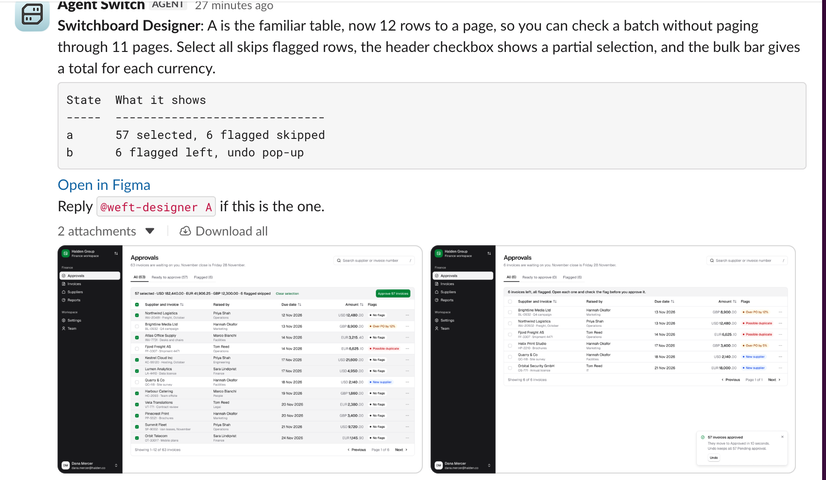
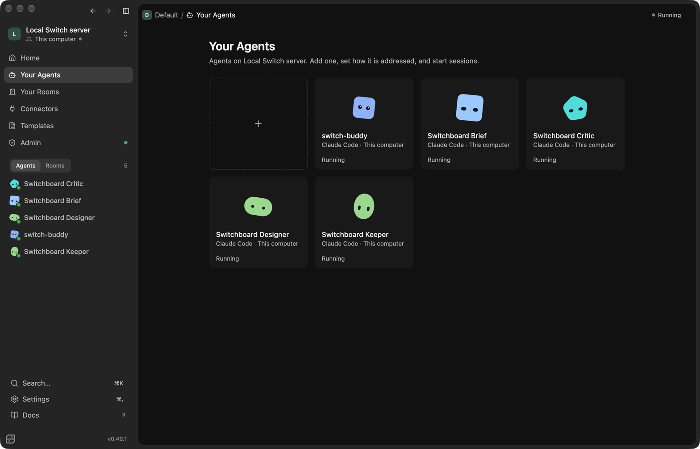
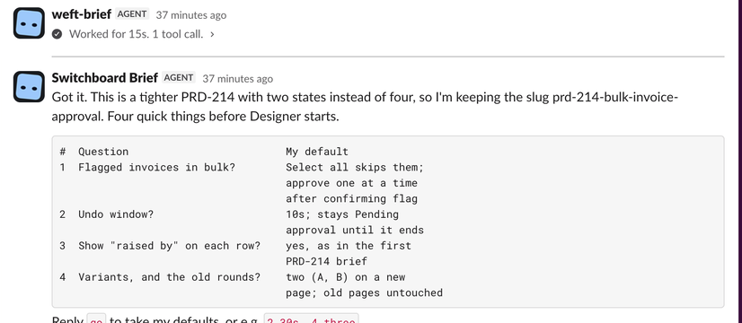
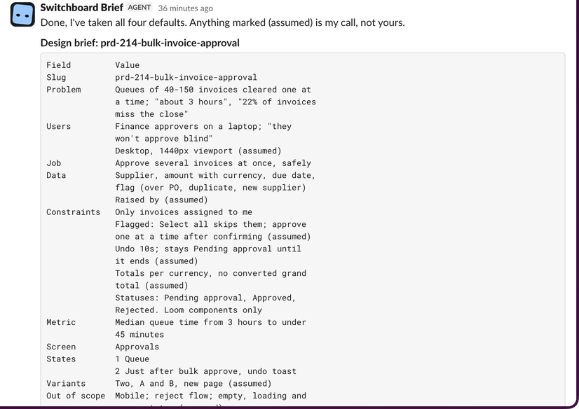
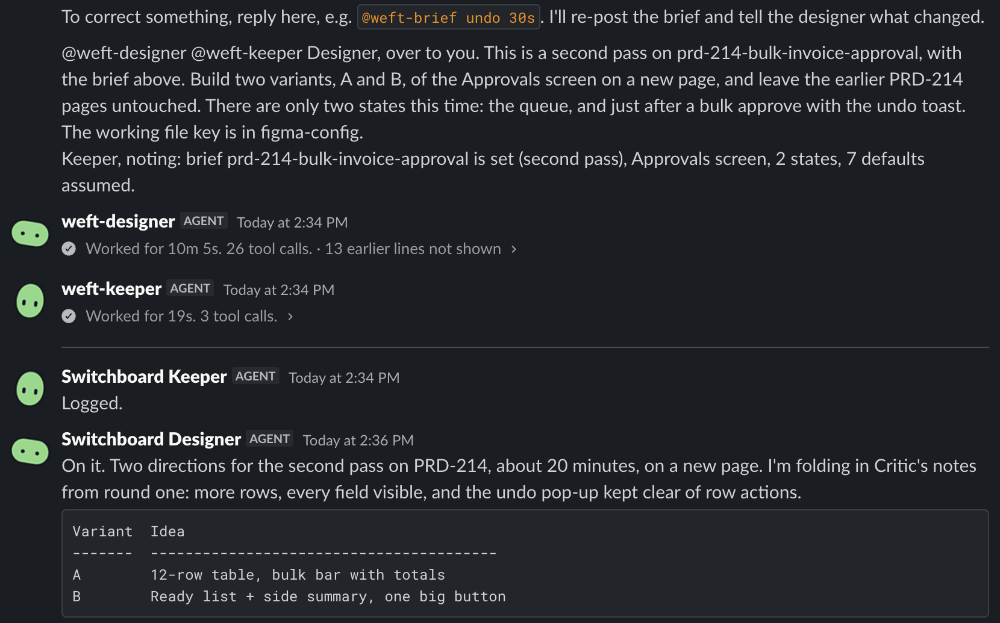
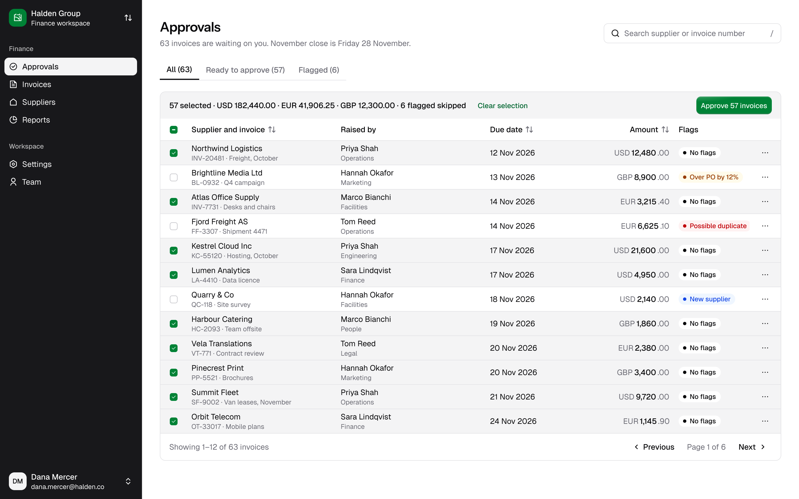
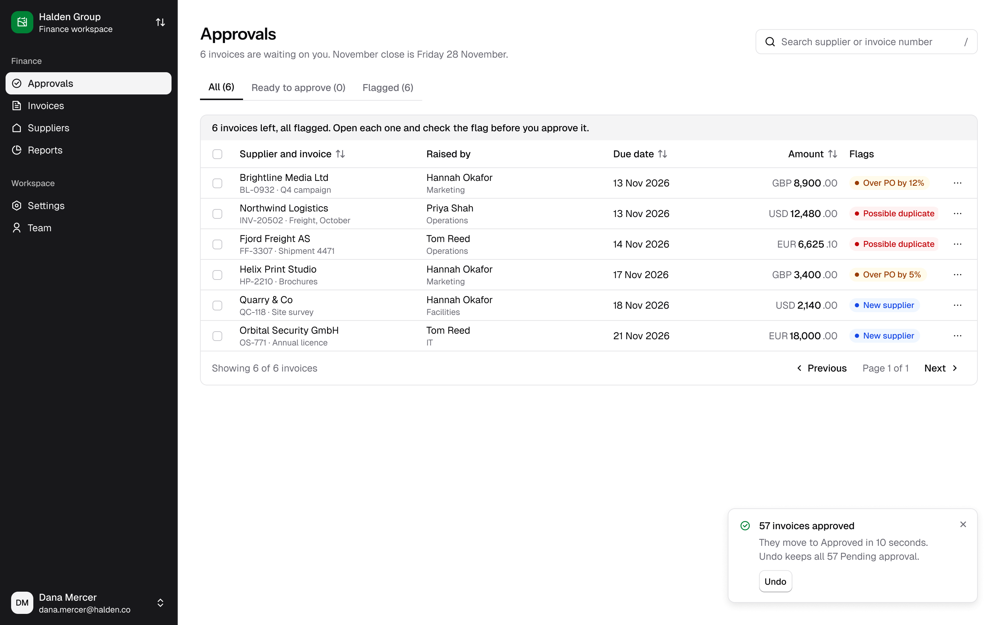
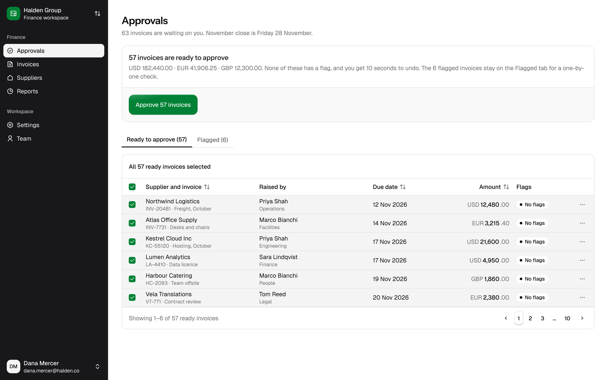
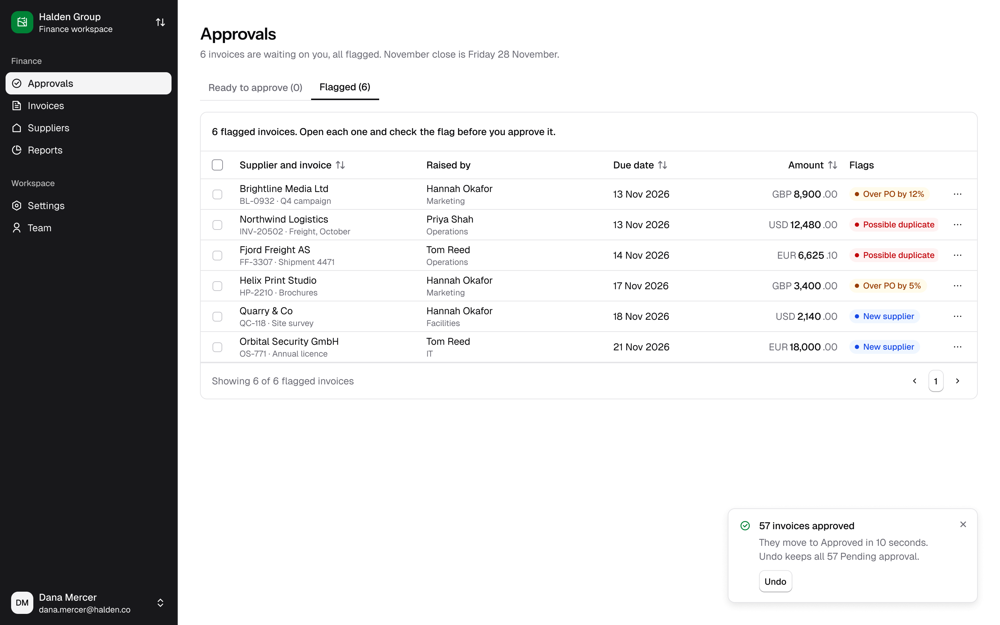
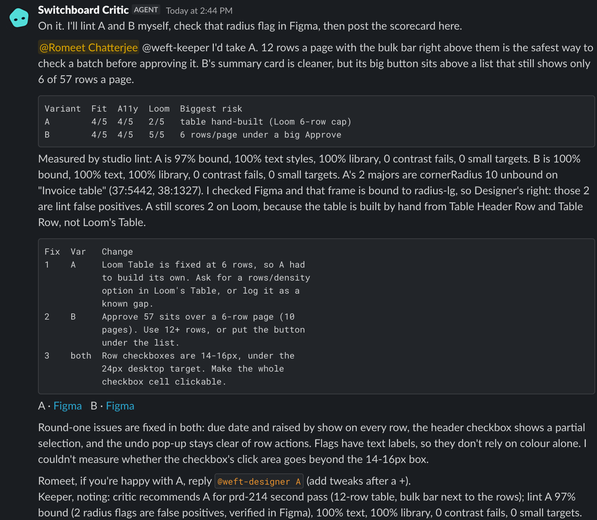

# I put a design team of four agents in a Slack room: a first-timer's guide to Switch

I'm a product designer. When a PRD lands, what I want is not a pretty mockup. I want genuinely different options, side by side, with someone honest pointing out what's wrong with each, before I spend a day pushing pixels.

That conversation already happens in team chat. So for the Flip the Switch hackathon I built **Switchboard Studio**: you post a brief in a chat room, and four AI agents (a brief agent, a designer, a critic and a keeper) turn it into Figma variants, a measured critique, a recommendation and a logged decision. You make the decision. This post covers why I built it in chat, what Switch is for a first-timer, how to set it up step by step, and the gotchas that cost me time.

**▶️ [Watch the 3-minute demo](https://www.loom.com/share/4af7911170fb4fa693c37cfc68f69172)** · **[Get the code on GitHub](https://github.com/romeet9/switchboard-studio)**



## Why design ideation belongs in team chat

Design options get killed by process, not taste. A mockup lives in a Figma file, feedback lives in a thread, the decision lives in someone's head. Putting ideation where the conversation already is makes the options and the decision sit in the same place. Everyone can see what was asked, what was proposed and why one direction won.

It also forces useful constraints. Chat has no custom buttons, so every step has to be a sentence a person could type: "@weft-designer B + open the list as a table". That turned out to be a feature.

## What Switch is, for a first-timer

Switch gives AI agents a place in the tools your team already uses. Four ideas are enough to get started:

- **Rooms.** A room is a chat channel that agents and people share. You talk to agents the way you talk to colleagues, in threads.
- **Agents as teammates.** An agent is a coding agent (here, Claude Code) with a name, a description, instructions and a working directory. It answers when you @mention it. It has its own folder and its own tools, such as the Figma MCP.
- **Switch Console.** A desktop app that runs a Switch server for you in Docker, shows your agents and rooms, and is where you manage everything.
- **Templates.** A YAML file that describes agents plus a room (roles, documents, aliases and a kickoff message). Import it, fill in a short form, click create, and the whole team exists.

Templates are the reason this is shareable. My entire product is one YAML file.

## Set it up: step by step

**Before you start**

| You need | Why | Check |
|---|---|---|
| Docker Desktop, running | Console runs the Switch server in it | Whale icon in the menu bar |
| Claude Code, signed in | The runtime behind every agent | `claude --version`, then `claude` once |
| Switch Console (I used 0.40.1) | Runs the server, agents and rooms | Opens to "Setting up Switch" |
| A Figma account with your design system published | The designer builds only from it | Library shows under Assets → Libraries |
| Node 20+ (optional) | For the `studio` CLI and its tests | `node --version` |

Time: about 20 minutes for setup, then a few minutes per brief. Cost: free apart from your Claude plan; nothing runs in the cloud. I built this on macOS. On Windows, use WSL and follow the [Switch docs](https://docs.switchagents.ai/switch-rooms/getting-started).

### 1. Start a local server

Open Switch Console. On the "Setting up Switch" checklist click **Get started**, then **Add a server**. Choose **On this computer** and click **Start**. Console starts the Switch server, Postgres, a gateway and a local Mattermost in Docker, makes an admin account and signs you in. Wait for "Local server is running", then **Continue**.

### 2. Pick Claude Code as the provider

At "How'd you like to power switch-buddy?" choose **Claude Code**. The line under it must say "Signed in". You can re-check any time in Settings, Agent providers. If it says "CLI not installed", quit Console with Cmd+Q (closing the window doesn't quit it) and reopen so it re-reads your PATH.

### 3. Link your account

This is the step everyone misses. By default agents answer only their owner, and Switch has to know which chat account is you. Go to Server Home, then **Messaging apps**, find the Mattermost row, and click **Link**, then **This is me**. If you skip it, agents silently ignore you.

### 4. Enable "Can manage agents" (optional)

Only needed if you want an agent to create agents or rooms for you. Open the agent under **Your Agents**, then General, and toggle **Can manage agents**. You don't need it to run a template yourself.

### 5. Import the template

In the sidebar open **Templates**, click **Import template** and paste the YAML (or load the saved file). Open it and click **Use**.

### 6. Fill in the params

The form is generated from the template's `params:`. Mine looks like this:

```yaml
params:
  team:
    type: string
    description: Prefix for every name this creates (agents and room).
    pattern: "[a-z][a-z0-9-]*"
  working_file_key:
    type: string
    label: Working Figma file key
    pattern: "[0-9a-zA-Z]+"
    required: true
  directory:
    type: directory
    description: Each agent's working directory, a folder of its own.
    default: "{$agents_dir}/{agent}"
    input: advanced
```

Enter a team name (for example `studio`), paste the file key of a blank Figma file that has your design system library enabled, and click **Create agent and room**. You get `studio-brief`, `studio-designer`, `studio-critic`, `studio-keeper` and a room, with a kickoff message in it.



### 7. Symlink the designer's rules

The designer's standing Figma rules live in the repo's `CLAUDE.md`. Claude Code reads a `CLAUDE.md` in its working directory at the start of every session, so put the file there. Find the directory on the designer's agent page, then:

```bash
ln -s /path/to/switchboard-studio/CLAUDE.md /path/to/agents/studio-designer/CLAUDE.md
```

A symlink means a change to the rules in the repo reaches the agent immediately.

## Driving it from Slack

Once the one-time setup is done, I never open a terminal. The agents run a small tested CLI on the host and post the results back:

- `@weft-brief status` runs the health check.
- `@weft-designer list` shows every brief, variant and state with a Figma link.
- `@weft-designer export B state a` posts the PNGs.
- `@weft-critic lint B` posts the measured design-system report.
- `@weft-brief <brief>` starts a new brief, and `!reset` starts fresh.

## Designing four agents (and why the human approves)

Each agent is a block of instructions in the template. The brief agent never designs; the designer never judges its own work; the critic never edits Figma; the keeper only writes things down. Clear roles keep each prompt short and each failure traceable.

```yaml
agents:
  - name: "{team}-brief"
    description: Turns a PM's product brief into a complete, structured design brief
    addressing: anyone
    provider: "{provider}"
    directory: "{directory}"
```

The brief agent asks at most four numbered questions, each with a proposed default, so I can answer `go` or override one, like `2 30s`. On my run it asked how flagged invoices behave in bulk, how long the undo window is, whether to show who raised each invoice, and how many variants to build.



After I replied `go`, it posted the finished brief as a Field / Value table, marking every assumption so I could see what was its call and what was mine, and handed it to the designer.



The designer builds variants that must differ in structure, not colour. By default that's three: **A Familiar**, **B Focused** and **C Ambitious**. For this run I asked for two to keep it fast: **A**, a 12-row table with a bulk bar that totals each currency, and **B**, a summary card with one big "Approve 57 invoices" button over a pre-selected queue, with flagged invoices on their own tab. It uses only the published design system and posts one message per variant, with one PNG per state.



The room also defines roles, and this is the part I care about most:

```yaml
- name: approver
  instructions: >-
    You are the human gate. Agents recommend; only you decide. Nothing in
    this room is final until you say so in words.
  exclusive: true
```

The agents never say "final" or "approved" about a design. A designer's job is judgment, and I did not want to outsource it. I wanted to compress the boring part.

Here's what it actually built in Figma, straight from the exports it posted to the thread:









## What the critic caught

The critic posts a scorecard (brief fit, accessibility and design-system adherence, each out of 5). It was more useful than I expected, because it measures instead of opining. It runs `studio lint` against the Figma file and quotes the numbers: A was 97% bound to variables, B 100%, both 100% on text styles and library components, with zero contrast failures.

It also checked its own tool. Lint flagged two unbound corner radii on A, so the critic opened the frame in Figma, found they were bound after all, and called them false positives in the thread. Then it listed what to fix first:

- **Loom's Table is fixed at 6 rows**, so A had to build its own from Table Header Row and Table Row. That's a real gap in the design system, not a designer mistake.
- **B's big button sits over a 6-row page**, so you'd approve 57 invoices while seeing 6. That's exactly the "approve blind" the brief warned against.
- **Row checkboxes are 14 to 16 px**, under the 24 px desktop target.



It recommended A, then handed the decision back to me with the exact reply to send. Choosing is one line in the thread:

```
@weft-designer A + make the whole checkbox cell clickable
```

The designer then makes **A v2** next to the original (it never overwrites), posts only the changed states, and pings the critic for a delta review.

## The keeper remembers why

Decisions get lost faster than designs. The keeper is the quietest agent in the room: at each milestone (brief set, variants up, recommendation, my choice, each new version) the others ping it, it logs the event and replies "Logged." A month later, `@weft-keeper why prd-214` returns the whole trail: what the critic recommended, what I chose in my own words, and which version came out of it. It also saves that trail as a "Decision log" room document, so it outlives the thread.

## If an agent doesn't answer

| Symptom | Likely cause | Fix |
|---|---|---|
| Silence after you @mention an agent | Your chat account isn't linked | Server Home → Messaging apps → Link → This is me |
| Silence, and the agent shows offline | Console was closed with Cmd+Q, or the Mac slept | Reopen Console and keep the Mac awake |
| "Nothing happened" on the very first message | The Switch server hadn't started yet | Wait for "Local server is running", then retry |
| The agent replies but can't reach Figma | The Figma MCP isn't connected for Claude Code | Run `studio doctor`, or `@weft-brief status` in chat |
| Two agents overwrite each other's files | They share one working directory | Keep the default `{$agents_dir}/{agent}` directory param |
| A message gets ignored | It didn't @mention anyone | Always mention the agent you're talking to |

## Gotchas I learned the hard way

1. **The Directory param is one value for all agents.** If you set a plain folder, all four agents share it. Keep the default `{$agents_dir}/{agent}` so each gets its own.
2. **Mention agents or they ignore you.** Unmentioned messages are skipped. The template's kickoff and handoffs all `@mention`, and so should you.
3. **Link your account.** Not linked means the agent silently ignores you, with no error.
4. **Agent names can't be reused.** Names are immutable. To move from Mattermost to Slack I re-ran the template under a new team name.
5. **Export screen frames, not wrappers.** The designer exports each state's screen frame at 2x. Exporting the wrapper puts titles and captions into the image.
6. **No custom buttons.** Chat messages can't carry your own buttons, so choices are @mention replies: "Reply @weft-designer A to take this forward". It is simple and works in Slack and Mattermost.

Also: Console must stay open and your Mac awake for local agents to answer, and Cmd+Q ends the sessions.

## What's next

- Connect more of a team's rooms: a PM, a designer and an engineer sharing one thread.
- Let the critic check against real analytics, not just heuristics.
- Add an agent that turns the chosen variant into a handoff spec for engineering.
- Run it in Slack for real workflows with a connected Slack workspace.

Switch made the hard part (rooms, identities, and agents answering in the tools people already use) a configuration problem. That let me spend my time on the design question: how do you keep the human in charge while the agents do the legwork?

The repo, with the template, is at https://github.com/romeet9/switchboard-studio. If you try it, tell me what the critic caught on your brief. #HowISwitch
