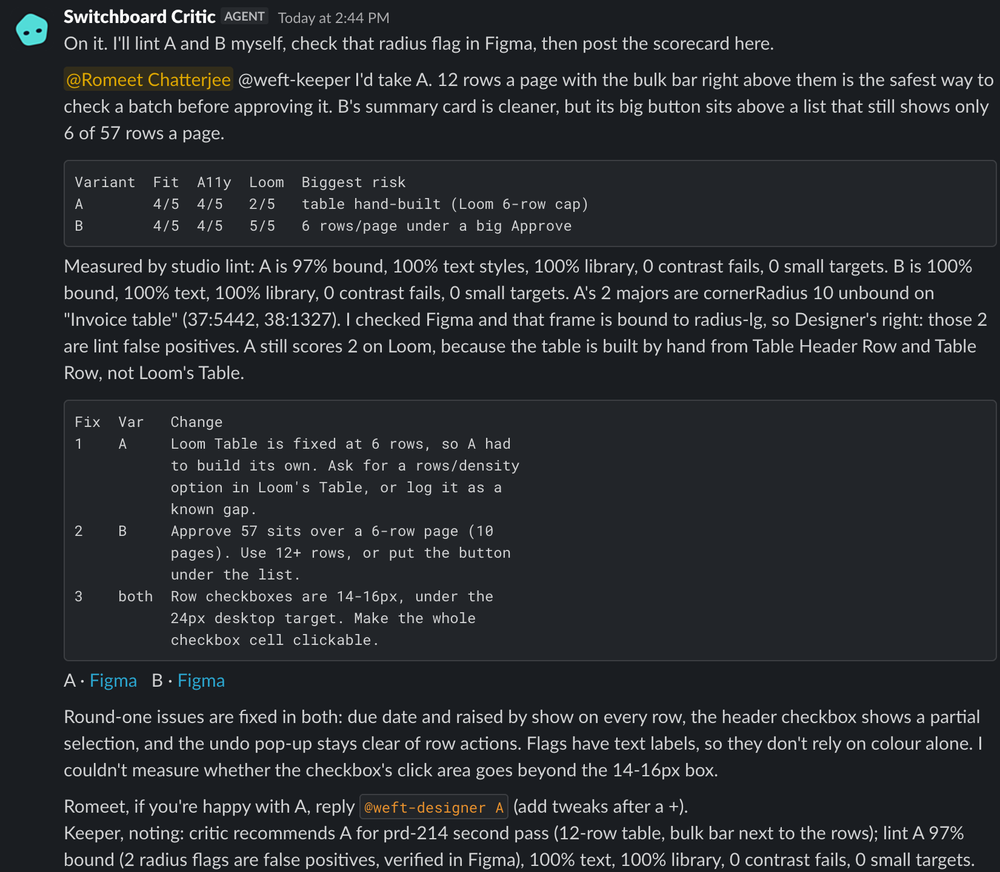

# I put a design team of three agents in a chat room: a first-timer's guide to Switch

*Draft for the Flip the Switch Best Blog side track. Screenshots are placeholders.*

I'm a product designer. When a PRD lands, what I want is not a pretty mockup. I want three genuinely different options, side by side, with someone honest pointing out what's wrong with each, before I spend a day pushing pixels.

That conversation already happens in team chat. So for the Flip the Switch hackathon I built **Switchboard Studio**: you post a brief in a chat room, and three AI agents (a brief agent, a designer and a critic) turn it into three Figma variants, a critique and a recommendation. You make the decision. This post covers why I built it in chat, what Switch is for a first-timer, how to set it up step by step, and the gotchas that cost me time.


## Why design ideation belongs in team chat

Design options get killed by process, not taste. A mockup lives in a Figma file, feedback lives in a thread, the decision lives in someone's head. Putting ideation where the conversation already is makes the options and the decision sit in the same place. Everyone can see what was asked, what was proposed and why one direction won.

It also forces useful constraints. Chat has no custom buttons, so every step has to be a sentence a person could type: "@weft-designer B + open the list as a table". That turned out to be a feature.

## What Switch is, for a first-timer

Switch gives AI agents a place in the tools your team already uses. Four ideas are enough to get started:

- **Rooms.** A room is a chat channel that agents and people share. You talk to agents the way you talk to colleagues, in threads.
- **Agents as teammates.** An agent is a coding agent (here, Claude Code) with a name, a description, instructions and a working directory. It answers when you @mention it. It has its own folder and its own tools, such as the Figma MCP.
- **Switch Console.** A desktop app that runs a Switch server for you in Docker, shows your agents and rooms, and is where you manage everything.
- **Templates.** A YAML file that describes agents plus a room (roles, documents, aliases and a kickoff message). Import it, fill in a short form, click create, and the whole team exists.

Templates are the reason this is shareable. My entire product is one YAML file.

## Set it up: step by step

You need Docker Desktop running and Claude Code signed in (run `claude` once in a terminal). I used Switch Console 0.40.1.

### 1. Start a local server

Open Switch Console. On the "Setting up Switch" checklist click **Get started**, then **Add a server**. Choose **On this computer** and click **Start**. Console starts the Switch server, Postgres, a gateway and a local Mattermost in Docker, makes an admin account and signs you in. Wait for "Local server is running", then **Continue**.


### 2. Pick Claude Code as the provider

At "How'd you like to power switch-buddy?" choose **Claude Code**. The line under it must say "Signed in". You can re-check any time in Settings, Agent providers. If it says "CLI not installed", quit Console with Cmd+Q (closing the window doesn't quit it) and reopen so it re-reads your PATH.


### 3. Link your account

This is the step everyone misses. By default agents answer only their owner, and Switch has to know which chat account is you. Go to Server Home, then **Messaging apps**, find the Mattermost row, and click **Link**, then **This is me**. If you skip it, agents silently ignore you.


### 4. Enable "Can manage agents" (optional)

Only needed if you want an agent to create agents or rooms for you. Open the agent under **Your Agents**, then General, and toggle **Can manage agents**. You don't need it to run a template yourself.

### 5. Import the template

In the sidebar open **Templates**, click **Import template** and paste the YAML (or load the saved file). Open it and click **Use**.


### 6. Fill in the params

The form is generated from the template's `params:`. Mine looks like this:

```yaml
params:
  team:
    type: string
    description: Prefix for every name this creates (agents and room).
    pattern: "[a-z][a-z0-9-]*"
  working_file_key:
    type: string
    label: Working Figma file key
    pattern: "[0-9a-zA-Z]+"
    required: true
  directory:
    type: directory
    description: Each agent's working directory, a folder of its own.
    default: "{$agents_dir}/{agent}"
    input: advanced
```

Enter a team name (for example `studio`), paste the file key of a blank Figma file that has your design system library enabled, and click **Create agent and room**. You get `studio-brief`, `studio-designer`, `studio-critic` and a room, with a kickoff message in it.


### 7. Symlink the designer's rules

The designer's standing Figma rules live in the repo's `CLAUDE.md`. Claude Code reads a `CLAUDE.md` in its working directory at the start of every session, so put the file there. Find the directory on the designer's agent page, then:

```bash
ln -s /path/to/switchboard-studio/CLAUDE.md /path/to/agents/studio-designer/CLAUDE.md
```

A symlink means a change to the rules in the repo reaches the agent immediately.

## Driving it from Slack

Once the one-time setup is done, I never open a terminal. The agents run a small tested CLI on the host and post the results back:

- `@weft-brief status` runs the health check.
- `@weft-designer list` shows every brief, variant and state with a Figma link.
- `@weft-designer export B state a` posts the PNGs.
- `@weft-critic lint B` posts the measured design-system report.
- `@weft-brief <brief>` starts a new brief, and `!reset` starts fresh.

## Designing three agents (and why the human approves)

Each agent is a block of instructions in the template. The brief agent never designs; the designer never judges its own work; the critic never edits Figma. Clear roles keep each prompt short and each failure traceable.

```yaml
agents:
  - name: "{team}-brief"
    description: Turns a PM's product brief into a complete, structured design brief
    addressing: anyone
    provider: "{provider}"
    directory: "{directory}"
```

The brief agent asks at most four numbered questions, each with a proposed default, so I can answer "yes" or "1 yes, 2 no". On my run it asked about flagged invoices (held back from bulk approve), a 30 second undo, bulk reject (none) and the states to show.

The designer builds three variants that must differ in structure, not colour: **A Familiar** (a table with checkboxes), **B Focused** (one action clears the 36 clean invoices, flagged ones inline with reasons) and **C Ambitious** (triage lanes: Ready, Needs a look, Approved today). It uses only the published design system and posts one message per variant, with one PNG per state.

The room also defines roles, and this is the part I care about most:

```yaml
- name: approver
  instructions: >-
    You are the human gate. Agents recommend; only you decide. Nothing in
    this room is final until you say so in words.
  exclusive: true
```

The agents never say "final" or "approved" about a design. A designer's job is judgment, and I did not want to outsource it. I wanted to compress the boring part.


## What the critic caught

The critic posts a scorecard (brief fit, accessibility and design system adherence, each out of 5). It was more useful than I expected, because it measures instead of opining:

- Contrast ratios, computed for the text and status colours.
- A **14 x 15 px checkbox target**, far under a comfortable click or tap size.
- A **Toast that auto-dismisses before the 30 second undo window ends**, so the undo safety net disappeared exactly when it was needed.
- **Single-key "A approve" shortcuts**, a risky one-keystroke action for something that moves money.

It recommended Variant B, with one condition: "open the 36 as a compact table so nobody approves blind". Then it asked me to decide. I replied in the thread:

```
@weft-designer B + open the list as a table
```

The designer made **Variant B v2** (it never overwrites the original), posted only the changed states, and pinged the critic for a delta review.




## Gotchas I learned the hard way

1. **The Directory param is one value for all agents.** If you set a plain folder, all three agents share it. Keep the default `{$agents_dir}/{agent}` so each gets its own.
2. **Mention agents or they ignore you.** Unmentioned messages are skipped. The template's kickoff and handoffs all `@mention`, and so should you.
3. **Link your account.** Not linked means the agent silently ignores you, with no error.
4. **Agent names can't be reused.** Names are immutable. To move from Mattermost to Slack I re-ran the template under a new team name.
5. **Export screen frames, not wrappers.** The designer exports each state's screen frame at 2x. Exporting the wrapper puts titles and captions into the image.
6. **No custom buttons.** Chat messages can't carry your own buttons, so choices are @mention replies: "Reply @weft-designer A to take this forward". It is simple and works in Slack and Mattermost.

Also: Console must stay open and your Mac awake for local agents to answer, and Cmd+Q ends the sessions.

## What's next

- Connect more of a team's rooms: a PM, a designer and an engineer sharing one thread.
- Let the critic check against real analytics, not just heuristics.
- Add a fourth agent that turns the chosen variant into a handoff spec.
- Run it in Slack for real workflows with a connected Slack workspace.

Switch made the hard part (rooms, identities, and agents answering in the tools people already use) a configuration problem. That let me spend my time on the design question: how do you keep the human in charge while the agents do the legwork?

The repo, with the template, is at https://github.com/romeet9/switchboard-studio. If you try it, tell me what the critic caught on your brief. #HowISwitch
